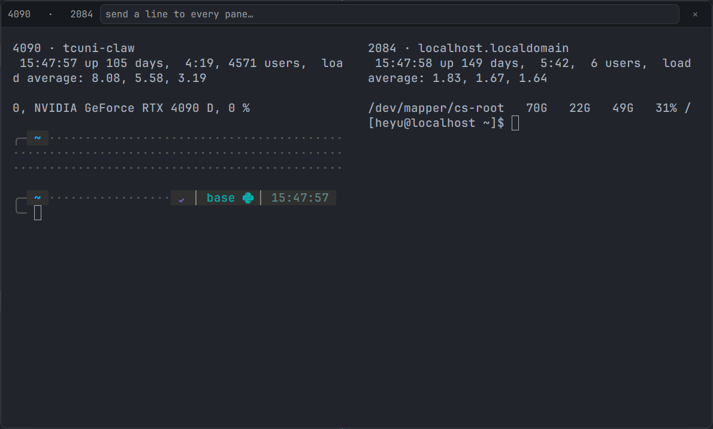

# xsplit

English | [简体中文](README.zh-CN.md)

Terminals from several machines side by side in one floating window, with one line
box that sends what you type to all of them at once.



Herdr keeps a tab inside one machine: every pane of a tab runs in that space's core,
so `pane.split` can only split the machine you are already on. A mod can't change
that. It *can* put terminals from any number of machines in one window, because a
window's layout takes blocks whose content is a terminal address and those addresses
are machine-qualified (`4090/t1f`, `5090/t2`). This mod is that window, the picker
that opens it, and a strip you can park in your layout to launch it.

## Install

```sh
cd ~/.config/herdr-app
git clone https://github.com/Raquelle97/herdr-xsplit /tmp/xsplit
cp -r /tmp/xsplit/mods/xsplit mods/xsplit
herdr-app check mods/xsplit
```

Windows PowerShell:

```powershell
cd $HOME\.config\herdr-app
git clone https://github.com/Raquelle97/herdr-xsplit $env:TEMP\xsplit
Copy-Item -Recurse -Force "$env:TEMP\xsplit\mods\xsplit" mods\xsplit
herdr-app check mods\xsplit
```

Nothing appears on its own: this is not a docked panel, so it needs one of the three
entry points below.

## Open it

**A strip in your layout.** Add this block to a column of `layouts/<name>.json` and
switch the layout back on (`alt`+`l` picks a layout; saving the file reloads it):

```json
{ "id": "xsplit-launch", "type": "block",
  "content": { "mod": "xsplit", "props": { "launcher": true } }, "size": { "px": 30 } }
```

**A key.** Merge this into your `keys.json` — if you already have a `global` section,
add the line to it rather than replacing it:

```json
{ "global": { "alt-x": { "command": "tab.new", "args": { "mod": "xsplit" } } } }
```

**A command.** A tab whose only pane is the picker:

```sh
herdr-app do tab.new --mod xsplit
```

and a fixed set straight away, skipping the picker:

```sh
herdr-app do tab.new --mod xsplit --props '{"open":["4090/t1f","5090/t2"]}'
```

## The picker

A card with a `Cross-machine` header, the count of picked terminals, `Clear` once
something is picked, and `Open N`. Under it the live terminals, grouped by machine —
this computer first, then alphabetically by machine name — and inside a group by
address. Each row: a checkbox, the address in muted type, the program's name, the tail
of its folder, and the agent status when it has one. Click a row to pick it; picks are
remembered, so the next picker opens with the same ones ticked. The list re-reads
every 3 s and only redraws when the set of terminals actually changed.

`Open` makes one window, `420 + 24` px wide per terminal (capped at 1 560), 520 px
tall, one column per picked terminal.

## The bar

32 px across the top of the window:

- left: the machines in the window, in column order
- middle: a line box. Enter sends that line to **every** terminal in the window
  (`hc send --force <address> <text>`, one call per address) and reports
  `sent to N panes`, or `failed: 4090` for the ones that refused. It is a command
  broadcast, not a keystroke mirror: tmux's `synchronize-panes` behaviour — every key
  appearing in every pane as you type — has no API here.
- right: `×` closes the window. The terminals keep running; they are ordinary
  terminals of their machines.

## Limits

- It is a window, not a tab. No divider drag, no `pane.split`/`pane.close`/`pane.zoom`,
  and it is not saved with the tab.
- With a terminal inside the window focused, those pane commands fail by design: the
  composition belongs to the mod, so change the layout in `main.js` instead.
- Only terminals attached to a pane can be shown. A bare `hc run --bg` terminal has no
  pane and renders as an empty strip — the whole window collapses to its bar.
- Clicking a terminal inside the window focuses it, which can move the main view to
  that terminal's space. Use the window to look side by side, and to broadcast.
- The bar is a drag handle: double-clicking it maximizes the Herdr window.
- Opening again replaces the window (its `key` is fixed at `xsplit`), so a second
  opening doesn't stack.
- Windows: an IME swallows `ctrl-shift-m` before the app sees it, which is why the
  shipped key is `alt-x`.

## License

Apache-2.0.
