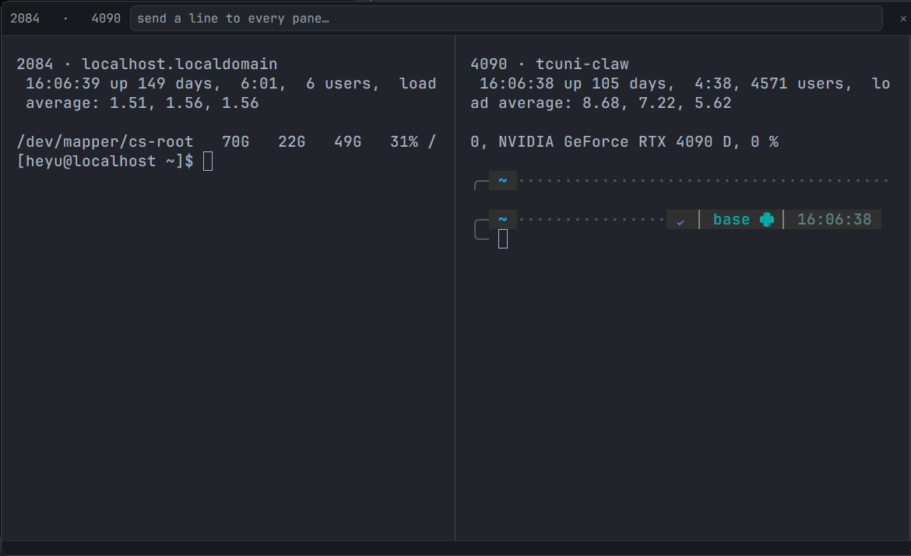

# xsplit

[English](README.md) | 简体中文

把几台机器的终端并排放在一个悬浮窗口里，顶部一行输入框，一次发给窗口里的所有终端。



Herdr 的 tab 归属于一台机器：一个 tab 的所有 pane 都跑在那个 space 所在的 core 上，
所以 `pane.split` 只能拆你已经在的那台机器。mod 改不了这一点，但可以换一种形态 ——
窗口（window）的布局里，block 的 content 可以是一个终端地址，而终端地址是带机器前缀的
（`4090/t1f`、`5090/t2`）。这个 mod 就是这个窗口，加上开窗的选择器，以及一条可以塞进
布局里的启动条。

## 安装

```sh
cd ~/.config/herdr-app
git clone https://github.com/Raquelle97/herdr-xsplit /tmp/xsplit
cp -r /tmp/xsplit/mods/xsplit mods/xsplit
herdr-app check mods/xsplit
```

Windows PowerShell：

```powershell
cd $HOME\.config\herdr-app
git clone https://github.com/Raquelle97/herdr-xsplit $env:TEMP\xsplit
Copy-Item -Recurse -Force "$env:TEMP\xsplit\mods\xsplit" mods\xsplit
herdr-app check mods\xsplit
```

装完不会自己冒出来：它不是常驻面板，需要下面三个入口之一。

## 打开

**布局里的一条**。把这块加到 `layouts/<name>.json` 的某个 column 里（保存即重载，
或用 `alt`+`l` 切一次布局）：

```json
{ "id": "xsplit-launch", "type": "block",
  "content": { "mod": "xsplit", "props": { "launcher": true } }, "size": { "px": 30 } }
```

**一个键**。合并进你的 `keys.json` —— 已经有 `global` 节的话是往里加这一行，不要整节替换：

```json
{ "global": { "alt-x": { "command": "tab.new", "args": { "mod": "xsplit" } } } }
```

**一条命令**。开一个只有选择器的 tab：

```sh
herdr-app do tab.new --mod xsplit
```

也可以跳过选择器直接开固定组合：

```sh
herdr-app do tab.new --mod xsplit --props '{"open":["4090/t1f","5090/t2"]}'
```

## 选择器

一张卡片：标题 `Cross-machine`，右边是已选数量、`Clear`（选了才出现）和 `Open N`。
下面是活着的终端，按机器分组 —— 本机在前，其余按机器名排序，组内按地址排序。每行是
勾选框、地址（弱化色）、程序名、所在目录的末段，有 agent 状态时再显示状态。点一行即选中，
选过的会被记住，下次打开自动带上。列表每 3 秒对一次，只有终端集合真的变了才重绘。

`Open` 开出一个窗口，宽度按每个终端 `420 + 24` px 累加（上限 1 560），高 520，
选了几个终端就几列。

## 窗口顶部的条

高 32 px：

- 左：窗口里各机器的名字，按列序
- 中：一行输入框。回车把这行发给窗口里**每一个**终端（`hc send --force <地址> <文本>`，
  逐个调用），完成后显示 `sent to N panes`，失败的按机器名报 `failed: 4090`。
  这是「命令级广播」，不是逐键镜像：tmux `synchronize-panes` 那种「你敲的每个键同时
  出现在每个 pane」的行为，这里没有 API。
- 右：`×` 关窗。终端不会停，它们仍是各台机器上的普通终端。

## 限制

- 它是窗口，不是 tab：没有分割线拖动，没有 `pane.split` / `pane.close` / `pane.zoom`，
  也不会跟 tab 一起保存。
- 它也不是操作系统的独立窗口：Herdr 只有一个窗口，它是浮在里面的一层。它会记住你放下的位置
  （`key`），浮在 pane 之上，点旁边不会关，但没法像真窗口那样拖到另一块屏。
- 各列等宽；列与列之间那条线是画出来的，拖不动 —— 终端 block 会先吃掉按下事件，布局的
  resize 边界收不到。
- 改尺寸靠两条 14 px 的边：底边拖宽度，右边拖高度。松手时才生效，窗口按新尺寸在同一位置重开。
- 窗口里的终端获得焦点时，上述 pane 命令按设计会失败 —— 组合归 mod 管，改布局要改
  `main.js`。
- 只能显示挂在 pane 上的终端。`hc run --bg` 那种游离终端没有 pane，放进去会渲染成一条
  空带，整个窗口塌成只剩顶部那根条。
- 点窗口里的终端会聚焦它，可能把主视图切到那台机器的 space。这个窗口适合并排看和广播，
  正经干活还是回到 tab 里。
- 顶部那条是拖动柄：双击它会把整个 Herdr 窗口最大化。
- 重复打开是替换而不是叠加（`key` 固定为 `xsplit`）。
- Windows 上 `ctrl-shift-m` 会被输入法先吃掉，所以默认给的是 `alt-x`。

## 许可

Apache-2.0。
