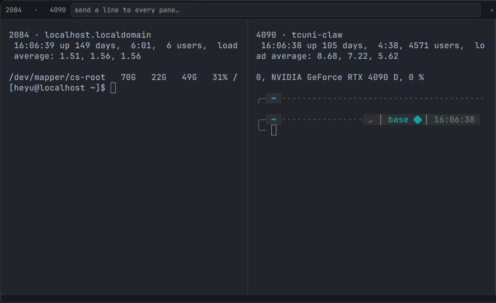

# xsplit

A Herdr mod: a floating window holding terminals from several machines at once — one
column each — with a line box at the top that sends one command to all of them. A
picker lists the live terminals by machine; a 30 px strip can sit in the layout and
open that picker on a click.

## What you see

Three things, one mod.

**The picker**, a card the size of the pane it is put in: radius 10, 1 px border in
the theme's `border`, background `background`, text `foreground` at 12.5 px.

- Header, 32 px, 10 px side padding, 8 px gaps, border beneath. Left to right:
  `Cross-machine` in semibold; then, in 11 px `dim`, either `N picked` or
  `pick terminals, then open`; pushed right `Clear` (only while something is picked,
  8 px × 3 px padding, radius 6, `dim`, `hover` background and `foreground` text under
  the pointer); then `Open N` (10 px × 3 px, radius 6, medium weight) — `accent`
  background with `accent_foreground` text once N > 0, `raised` with `dim` text while
  it is 0.
- An 11 px `accent` line under the header for the last action (`opened 2 panes`), only
  while there is one.
- The list, scrolling, 4 px top and bottom padding, 6 px between groups. One group per
  machine: an 11 px `dim` medium label (`this computer`, `4090`, `login07`), then rows
  26 px tall, 10 px side padding, 8 px gaps, `selected` background when picked, `hover`
  under the pointer. Each row: an 11 px check box (radius 3, 1 px border — `accent`
  when picked, `border` otherwise — filled `accent` when picked); the address in 11.5 px
  `muted`; the program's name in `foreground` (`zsh`, `Pi`, `codebuddy`…); the tail of
  its folder, flexing and truncating, in `dim`; the agent status in 11 px `accent` when
  the terminal reports one (`idle`, `done`).
- With nothing live: a 14 px padded `dim` line, `No live terminals. Open a space on a
  machine first.`

**The window**, one column per picked terminal, 420 + 24 px wide per column capped at
1 560, 520 px tall, with the bar across the top.

**The bar**, 32 px, 8 px side padding, 8 px gaps, `chrome` background, 1 px border
beneath, 11.5 px text:

- left: the machines in column order, `muted`, separated by three spaces and a middle dot
- middle: the line box, flexing, 24 px tall, 6 px radius, 1 px `border`, `background`
  fill, placeholder `send a line to every pane…`
- next: the result of the last broadcast, `dim` while sending and `accent` after
- right: `×`, 7 px × 2 px, radius 5, 13 px, `dim`, `hover` background and `foreground`
  text under the pointer

**The edges.** Two 14 px bands inside the window, both `chrome` with 1 px `border` on
the side that touches a terminal, 10 px `dim` text:

- along the bottom, full width, `◢` at the right end, cursor `ew-resize`, dragging it
  changes the width
- down the right side of the terminal row, full height, `⋮` centred, cursor `ns-resize`,
  dragging it changes the height

While a drag is in progress each one shows the pending number in `accent` (`1024 wide`,
`640 high`) instead of its glyph. The window's own frame has no resize handle, so these
are the only way to size it.

**The strip**, for a layout: full width of its block, 12 px side padding, 7 px gaps,
`chrome` background, 1 px `border` line above, 11.5 px `muted` text, `hover`
background under the pointer. Contents: `⇄` in 13 px `accent`, `Cross-machine` flexing
and truncating, `›` in `dim` at the right edge.

## How it behaves

- **Live terminals only.** The picker and the strip list `terminals()` filtered to
  `state === "live"` *and* whose address appears in `panes()` — a terminal with no pane
  cannot be drawn in a window block. Each render recomputes a fingerprint
  (`address:where`, sorted, joined); a 3 s timer compares and only then redraws.
- **Picking.** Clicking a row adds or removes its address in a `Set`, mirrored into the
  app-shared key `xsplit.pick`, so the next picker opens with the same rows ticked.
  `Clear` empties it. There is no keyboard handling at all.
- **Opening.** `Open` takes the picked terminals in list order (machines sorted with
  `this computer` first, then by name; addresses sorted inside a group) and calls
  `openOverlay({ kind: "window", key: "xsplit", width, height, layout })`. The layout is
  a column: a 32 px block carrying this same mod with
  `props.xsplitBar = { terms: [{ address, where }] }`, then a row of one block per
  address with `content: { terminal: address }`. The overlay id is kept in
  `xsplit.window`; the strip's own tile shows `opened N panes`.
- **Broadcasting.** Enter in the line box takes the trimmed text, clears the box, sets
  the hint to `sending…`, and goes through the addresses one at a time calling
  `hc(["send", "--force", address, text])` — paste, then Enter, even if a program is
  mid-draft. `code === 0` counts as delivered. The hint becomes `sent to N panes`, or
  `failed: 4090, 5090` naming the machines that refused. While it runs, further
  submissions are ignored.
- **Closing.** `×` closes `props().overlay` (the overlay tells the mod its own id in the
  props of a window block) or else the remembered `xsplit.window`, then sets that shared
  key to `null`. The terminals are untouched.
- **Resizing.** A window has no resize handle, and `openOverlay` is the only thing that
  sets a size, so the two bands fake one: `on_mouse_down` records the pointer and the
  size last opened (`shared("xsplit.size")`), `on_mouse_move` recomputes that one axis
  (`420…2400` wide, `220…1400` high), and `on_mouse_up` calls `openOverlay` again with
  the same `key` — the window comes back at the new size in the same place the person
  dropped it. Nothing resizes while the button is down; the number in the band is the
  preview. 32 px of bar and 14 px of bottom band are outside the body the height band
  spans, hence the `+ 46` when the height band starts a drag.
- **The strip** runs `tab.new { mod: "xsplit" }` on click — the same thing
  `herdr-app do tab.new --mod xsplit` does.
- **`props.open`** — a list of addresses — opens a window on the picker's first render
  and is then consumed, which is how a fixed set is launched from a shell.
- **Modes are chosen in `init`**: `props.launcher` → the strip; `props.xsplitBar` → the
  bar; neither → the picker. `render` dispatches on that.

## Built from

`mods/xsplit/` — `main.js` (one `View`, 444 lines), `mod.json` (`{ "place": "none" }`:
it must not dock itself), and this repo's `keys.json`
(`alt-x` → `{"command": "tab.new", "args": {"mod": "xsplit"}}`).

- `herdr`: `terminals`, `panes`, `theme`, `openOverlay`, `closeOverlay`, `props`,
  `shared`, `setShared`, `hc`, `run`.
- `gpui-kit`: `View`, `div`; `gpui-base`: `v_flex`, `h_flex`, `InputState`, `Input`.
  The bands use `on_mouse_down`/`on_mouse_move`/`on_mouse_up` with `cursor_ew_resize` /
  `cursor_ns_resize`, and `cx.stop_propagation()` so the press never starts a window drag.
- `hc send` is the only program run: `hc(["send", "--force", <address>, <text>])`.
- No images, no SVGs, no `exec`, no file reads. Glyphs are text (`⇄`, `›`, `×`).
- `preview.png` was taken from the app with `herdr-app shot` on a 4090 + a 2084 column,
  then cropped to the window's 1 px border.

## Watch out

- **A window block only draws a terminal that has a pane.** A bare `hc run --bg`
  terminal renders as an empty strip and the window collapses to its bar — the first
  build looked like "the window is broken" for exactly this reason. Hence the `panes()`
  filter in `shown()`.
- **The bar's root needs `.w_full()`.** Without it the bar is only as wide as its
  content and the window looks like a floating label.
- **`key` is what makes reopening replace.** With `key: Date.now()` every open stacked
  another window on the same spot; `key: "xsplit"` replaces.
- **The overlay passes its own id in `props`**, and only to the window's blocks. Keep the
  `props().overlay ?? shared("xsplit.window")` fallback: after a window is closed from
  elsewhere the shared id goes stale, and a `Close window` button driven by it lies.
- **`on_size_change` on the same element kills the drag.** With it attached the
  `on_mouse_up` never arrived: the band showed its pending number for ever and the
  window never moved. Measuring the window another way (or not at all, and keeping the
  opened size in `shared`) is what makes the release land.
- **A press a few pixels off the band drags the whole window** instead of resizing it —
  the band is only 14 px and the rest of the window is a `window_drag` region. Aim at
  the band, not at the window edge.
- **The bar is a drag handle** — the block sits in a `window_drag` region, so a double
  click maximizes the whole app window. Automation that clicks the bar twice will
  maximize Herdr.
- **A focused terminal inside the window disables pane commands** (`pane.split`,
  `pane.close`, `pane.zoom`, `terminal.show` fail by design). Composition belongs to the
  mod; change the layout in `main.js`.
- **Clicking a terminal inside the window can move the main view** to that terminal's
  space. Don't click one while taking a screenshot of something else.
- **The strip is narrow.** An earlier version right-aligned a count (`9 machines`) and
  the sidebar clipped it; the label is `flex_1().truncate()` and the count is gone for
  that reason.
- **Windows IMEs eat `ctrl-shift-m`** before the app sees it — a binding that never
  fires. `alt-x` arrives; `f9` did too. Always press a new binding once and check that
  the picker tab appears.
- `mod.json`'s `place` docks a copy only the first time Herdr sees the folder, and a
  picker has no business being a docked panel, so `none` is deliberate: the strip, the
  key or a shell command starts it.

## Done when

1. `herdr-app check mods/xsplit` prints `check passed`.
2. With a live terminal on two machines, `alt-x` (or the strip) opens a tab whose pane
   is the picker, listing both under their machine names, `this computer` first.
3. Picking one on each and pressing `Open 2` gives a window with one column per
   terminal; typing in either column reaches that machine's shell.
4. Typing `echo hi` in the bar and pressing Enter prints `hi` in both columns and the
   bar reports `sent to 2 panes`.
5. `×` closes the window and both shells are still running afterwards.
6. Dragging the bottom band left makes the window narrower and dragging the right band
   down makes it taller; both keep the window where it was, and a press 2 px inside the
   edge instead moves the whole window.
7. Reopening the picker shows the same two rows ticked.
8. `herdr-app do tab.new --mod xsplit --props '{"open":["<a>","<b>"]}'` opens the window
   without showing the picker first.
